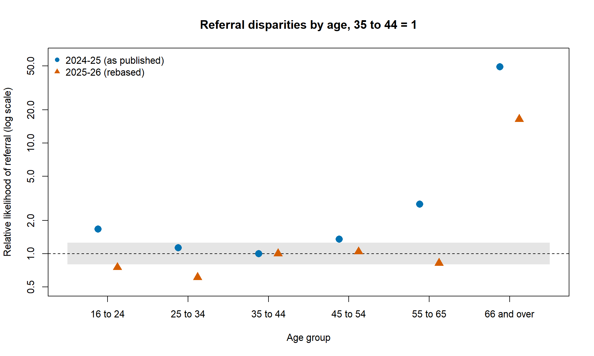

# UC Advances model: rebasing DWP's age disparity figures

In my MPA dissertation I studied how DWP assesses the Universal Credit
Advances fraud-risk model. One thing I noticed was that DWP changed the
comparator age group between its two published assessments: 35 to 44 in
2024-25, but 25 to 34 in 2025-26. The report does not flag this, and it
means the two years' figures cannot be compared directly.

In this project I use R to put the 2025-26 figures back on the 35 to 44
comparator, so both years can be compared on the same basis.

## How the rebasing works

DWP reports relative likelihoods: a group's rate divided by the
comparator group's rate. If I divide one group's relative likelihood by
another group's, the old comparator cancels out:

    (rate_g / rate_old) / (rate_new / rate_old) = rate_g / rate_new

So I divided each 2025-26 age figure by the 35 to 44 figure. I then
applied DWP's own rule: a value below 0.80 or above 1.25 counts as
"notable".

## Result

| Age group | Referral 2024-25 | Referral 2025-26 (rebased) | Changed? |
|---|---|---|---|
| 16 to 24 | 1.67 (notably higher) | 0.75 (notably lower) | Yes |
| 25 to 34 | 1.13 (not notable) | 0.61 (notably lower) | Yes |
| 35 to 44 | 1.00 (comparator) | 1.00 (comparator) | No |
| 45 to 54 | 1.35 (notably higher) | 1.04 (not notable) | Yes |
| 55 to 65 | 2.80 (notably higher) | 0.82 (not notable) | Yes |
| 66 and over | 49.24 (notably higher) | 16.51 (notably higher) | No |

Once both years use the same comparator, four of the five age groups
change classification. 16 to 24 even reverses, from notably higher to
notably lower.

[WRITE ONE OR TWO SENTENCES HERE: what surprised you, or what this means
for how DWP reports its results.]

## Limits

I can only work with what DWP publishes. The figures are rounded to two
decimal places, so my rebased values are approximate. DWP gives no counts
or confidence intervals, so I cannot test whether the changes are
statistically significant, only apply the 0.80-1.25 rule. The 66 and over
group is about 0.1% of cases, so its numbers should not be read much into.

Two smaller points: DWP writes age bands as "16-24" in 2024-25 and
"16 to 24" in 2025-26, so I used the second form for both years. And in
the 2025-26 annex, the text (para. 29) and Table 7 disagree about which
illness group is the comparator; I followed the table.

## Data

`data/dwp_disparities.csv` has 24 rows (12 groups in each year), which I
typed in from the statistical annexes (tables 1-8) of:

- DWP (2025), Fairness assessment including statistical analysis of the
  Universal Credit advances machine learning model: 1 April 2024 to
  31 March 2025.
  https://www.gov.uk/government/publications/fairness-assessment-including-statistical-analysis-of-the-universal-credit-advances-machine-learning-model-1-april-2024-to-31-march-2025
- DWP (2026), Effectiveness assessment including statistical analysis of
  the Universal Credit advances machine learning model: 1 April 2025 to
  31 March 2026.
  https://www.gov.uk/government/publications/effectiveness-assessment-including-statistical-analysis-of-the-universal-credit-advances-machine-learning-model-1-april-2025-to-31-march-2026

Contains public sector information licensed under the Open Government
Licence v3.0.

## Running the code

You need R (I used 4.6.2); no extra packages. Open
`uc-advances-disparity-rebasing.Rproj` in RStudio, or set the working
directory to this folder, then run `code/03_plot.R`. It runs the other
two scripts first.

- `code/01_load_and_check.R` loads the data and stops if anything looks wrong
- `code/02_rebase_and_classify.R` does the rebasing and classification and
  saves `output/age_comparison_rebased.csv`
- `code/03_plot.R` draws the chart and saves `output/age_referral_rebased.png`

## About

Ulviyya Babayeva. The dissertation this builds on: *Transparent but
Untestable: How does the UK Department for Work and Pensions assess the
effectiveness of the Universal Credit Advances Model?* (MPA, UCL Institute
for Innovation and Public Purpose, August 2026).
